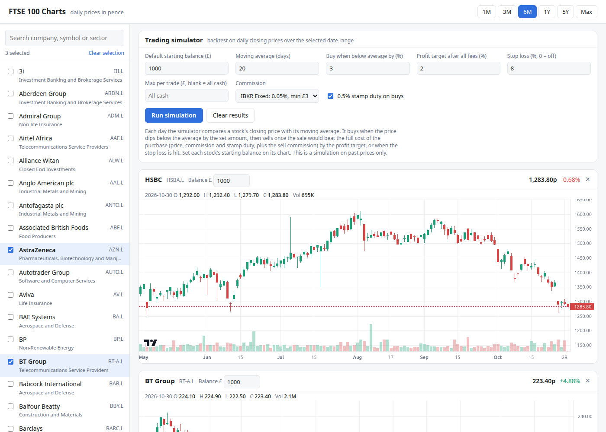
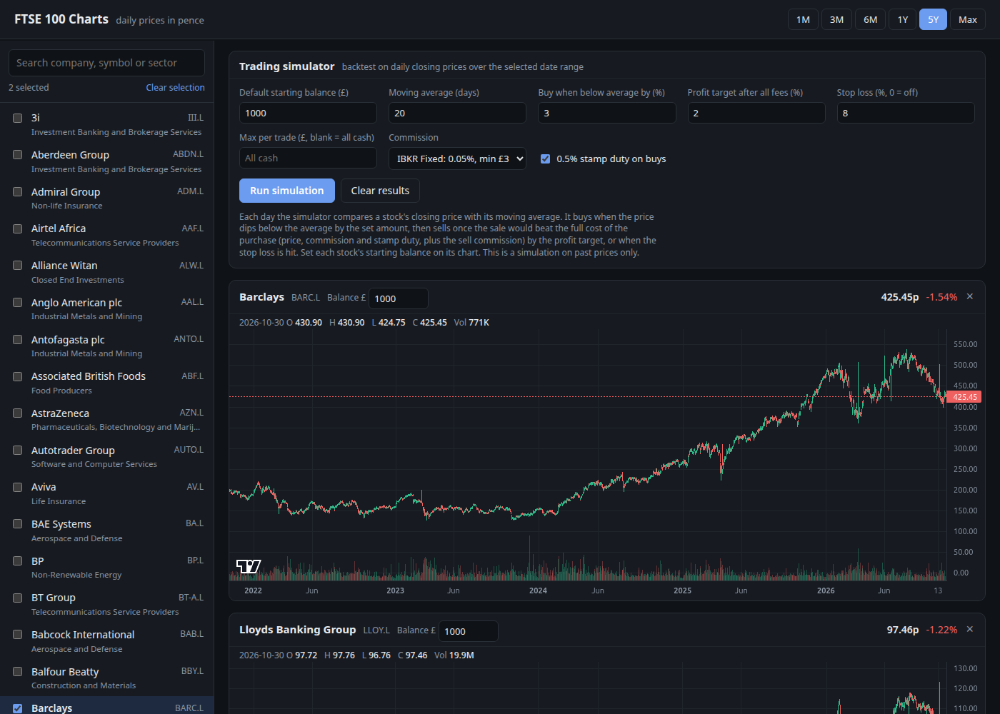
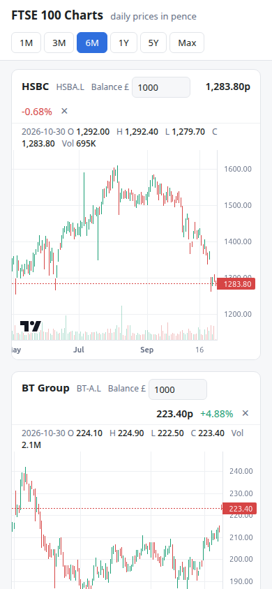
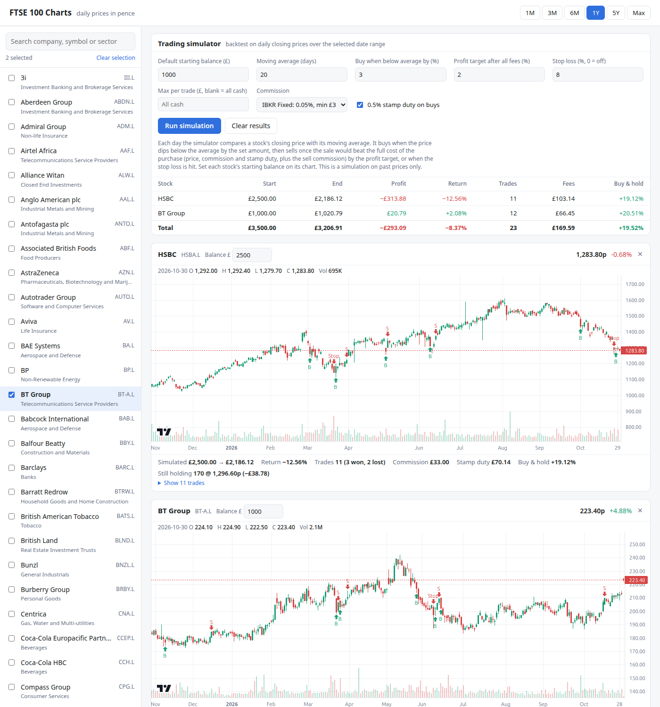

# FTSE 100 Ticker

Downloads daily price history for the current FTSE 100 constituents from Yahoo Finance (via [`yfinance`](https://pypi.org/project/yfinance/)) and stores it in MongoDB. A web UI charts the stored prices as candlesticks and includes a trading simulator that backtests a commission-aware strategy against UK broker fees. A command-line option prints current prices.



## Contents

- [Features](#features)
- [How the loader works](#how-the-loader-works)
- [Requirements](#requirements)
- [Installation](#installation)
- [Configuration](#configuration)
- [Usage](#usage)
- [Web UI](#web-ui)
- [Trading simulator](#trading-simulator)
- [Scheduling](#scheduling)
- [Data model](#data-model)
- [Testing](#testing)
- [Project structure](#project-structure)
- [Troubleshooting](#troubleshooting)
- [Limitations](#limitations)
- [Contributing](#contributing)
- [License](#license)

## Features

- Loads daily open/high/low/close/adjusted close/volume for all FTSE 100 constituents in one batch download.
- Backfills full history (back to 1968 for the oldest constituents) with `--period max`.
- Idempotent: re-running never creates duplicate rows; existing days are updated in place.
- Keeps the constituent list current from Wikipedia and flags companies that leave the index.
- Keeps working if Wikipedia is unavailable by falling back to the last stored constituent list.
- Prints current (≈15 minute delayed) prices with `--quote`.
- Web UI with interactive candlestick charts for any selection of stocks.
- Trading simulator that backtests a commission-aware strategy on the stored prices, with UK commission and stamp duty.
- Timestamped logging and a non-zero exit code on failure, suitable for cron.

## How the loader works

1. Reads the current constituent list from the [FTSE 100 Wikipedia page](https://en.wikipedia.org/wiki/FTSE_100_Index). If the scrape fails or returns too few rows (fewer than 90), it uses the previously stored current constituents; if none are stored, the load fails.
2. Converts each EPIC to Yahoo Finance format (for example, `BT.A` becomes `BT-A.L`).
3. Downloads OHLCV history using `yfinance` and upserts constituent and price documents into MongoDB.

The constituent list is refreshed on every successful scrape. Companies leaving the index remain in the database with `in_index: false`. Price writes are idempotent: a rerun updates an existing symbol/date record, including the current day's bar.

## Requirements

- Python 3 (developed on 3.12)
- A reachable MongoDB instance (developed against MongoDB 8)
- Internet access to Wikipedia and Yahoo Finance
- Packages pinned in `requirements.txt`: `yfinance`, `pymongo`, `pandas`, `lxml`, `requests`, `flask` (web UI), and `pytest` for tests

## Installation

```bash
git clone https://github.com/jamieharwood/ftse100-ticker.git
cd ftse100-ticker
python3 -m venv .venv
.venv/bin/pip install -r requirements.txt
```

The MongoDB database (`stocks`) and its collections and indexes are created automatically on the first run.

## Configuration

| Setting | Default | How to change |
|---|---|---|
| MongoDB connection | `mongodb://storenator.bluelarma.com:27017` | `MONGO_URI` environment variable |
| Database name | `stocks` | `DB_NAME` constant in `ticker.py` |
| History period | `5d` | `ticker.py --period` option |
| Web UI address | `127.0.0.1:5000` | `webapp.py --host` and `--port` options |
| Commission rates and stamp duty | IBKR UK fixed/tiered, 0.5% | `COMMISSION_PLANS` and `STAMP_DUTY_RATE` in `simulator.py` |

```bash
MONGO_URI=mongodb://localhost:27017 .venv/bin/python ticker.py
```

`MONGO_URI` applies to both `ticker.py` and `webapp.py`, and accepts any standard [MongoDB connection string](https://www.mongodb.com/docs/manual/reference/connection-string/), including credentials if your server requires them.

## Usage

Load the last five days (the default):

```bash
.venv/bin/python ticker.py
```

```text
2026-10-30 08:39:27,960 INFO 100 symbols, 500 rows: 100 inserted, 100 updated
```

Choose a different [yfinance period](https://ranaroussi.github.io/yfinance/reference/api/yfinance.download.html), for example to backfill full history:

```bash
.venv/bin/python ticker.py --period 1mo
.venv/bin/python ticker.py --period max
```

Print current prices without writing price history:

```bash
.venv/bin/python ticker.py --quote HSBA BT.A
.venv/bin/python ticker.py --quote
```

```text
HSBA.L      1283.40p  2026-10-30 08:24
BT-A.L       224.40p  2026-10-30 08:17
```

Provide EPICs (`BT.A`) or Yahoo symbols (`BT-A.L`), in any case. With no symbols, `--quote` uses the stored current constituents, so a MongoDB connection is still required. It shows the latest available one-minute price bar and its time; this is typically delayed by about 15 minutes, and outside trading hours it is the last close.

Run `.venv/bin/python ticker.py --help` for all options.

## Web UI

`webapp.py` serves a page of daily candlestick charts and the [trading simulator](#trading-simulator), using the data in MongoDB. It only reads from the database, so run `ticker.py` first to load prices:

```bash
.venv/bin/python webapp.py                  # http://127.0.0.1:5000
.venv/bin/python webapp.py --host 0.0.0.0   # also reachable from other machines on the LAN
```

- Tick stocks in the sidebar (searchable by company, symbol or sector) to add a chart for each; untick or press × to remove one.
- Choose a date range: 1M, 3M, 6M, 1Y, 5Y or Max.
- Each chart shows candles, volume, the latest close and its change from the previous day. Hover to see a day's open, high, low, close and volume.
- Scrolling or zooming one chart moves all the others to the same dates.
- The selection and range are kept in the URL, so you can bookmark a view, e.g. `/?symbols=HSBA.L,BT-A.L&range=6m`.

Stocks are shown as separate charts rather than overlaid because their prices differ by orders of magnitude. Charts are drawn with [TradingView Lightweight Charts](https://github.com/tradingview/lightweight-charts) 4.2.0, loaded from unpkg, so the browser needs internet access.

The page uses three JSON endpoints:

| Endpoint | Returns |
|---|---|
| `GET /api/stocks` | Current constituents: `symbol`, `company`, `sector`, sorted by company |
| `GET /api/prices/<symbol>?start=YYYY-MM-DD` | Daily bars `time`, `open`, `high`, `low`, `close`, `volume` in date order; `start` is optional |
| `POST /api/simulate` | Runs the [trading simulator](#trading-simulator); body `{"balances": {"HSBA.L": 1000}, "start": "YYYY-MM-DD", "params": {...}}` |

The page follows the system light or dark theme and stacks the stock list above the charts on narrow screens:

<p>
  
  &nbsp;
  
</p>

This uses Flask's built-in server, which is fine for personal use on a home network. Don't expose it to the internet.

## Trading simulator

The panel above the charts backtests a trading strategy on the stored daily prices of the selected stocks, over the selected date range. Each stock trades separately from its own starting balance, which you set in the **Balance £** box on its chart (new charts use the default balance from the panel).



### Strategy

On each trading day the simulator looks at the closing price, the "current price" for that day, and decides:

- **Buy** when the stock holds no position and the close is at least *Buy when below average by* % below its *Moving average* of closing prices. It buys as many whole shares as the cash (or *Max per trade*) covers after commission and stamp duty.
- **Sell (target)** when selling at the close would return the full cost of the position, including the purchase commission, stamp duty and the sell commission, plus the *Profit target*. A target sale therefore never loses money after fees.
- **Sell (stop)** when the close falls *Stop loss* % below the purchase price (0 turns this off).
- Otherwise **hold**.

Trades fill at the day's closing price. Bars just before the range seed the moving average, so trading can start on the first day of the range. A position still open at the end is valued at what selling it on the last day would raise.

### Costs

Commission follows the [Interactive Brokers UK (GBP) rates](https://www.interactivebrokers.co.uk/en/pricing/commissions-stocks.php?region=europe) for IB SmartRouting:

| Plan | Commission per order |
|---|---|
| Fixed (default) | 0.05% of trade value, minimum £3 |
| Tiered | 0.05% of trade value, minimum £1 (for monthly volume up to £40M); exchange and clearing fees are charged on top and aren't modelled |

UK stamp duty of 0.5% is added to every purchase (it can be switched off, for example for the few FTSE 100 shares registered outside the UK that are exempt). The rates are in `COMMISSION_PLANS` and `STAMP_DUTY_RATE` in `simulator.py`.

### Results

For each stock the chart shows buy (B), sell (S) and stop-loss (Stop) markers, the simulated end value, return, trade count with wins and losses, commission and stamp duty paid, any position still held, and a table of every trade. The panel totals all stocks. Every result is compared with **buy & hold**: buying on the first day with the same balance and fees and holding to the end.

With small balances the fees dominate. Every round trip costs about 0.6% (0.5% stamp duty plus commission) before minimums, and a £3 minimum is 0.3% of a £1,000 trade each way. Over most stocks and periods tested so far the strategy has trailed buy & hold. Use the simulator to explore how balance, thresholds and fees change that, but treat it as a model: it trades at closing prices with no slippage, spread or dividends.

## Scheduling

To load prices every weekday after the London Stock Exchange closes (16:30 UK time), add a crontab entry with `crontab -e`:

```cron
30 17 * * 1-5 cd /path/to/ftse100-ticker && .venv/bin/python ticker.py >> ticker.log 2>&1
```

The time is in the machine's timezone, so this assumes `Europe/London`. Cron only runs while the machine is on; the default five-day window fills in up to four missed trading days, and anything older needs a manual `--period 1mo` run.

Each run logs timestamped lines. Search the log for `WARNING` (constituent fallback, symbols with no data) or `ERROR` (failed run):

```bash
grep -E 'WARNING|ERROR' ticker.log
```

## Data model

`constituents` stores one document per symbol, uniquely indexed by `symbol`. Current members have `in_index: true`; former members remain with `in_index: false`:

```text
symbol, epic, company, isin, sector, in_index
```

`prices` stores one document per symbol and trading date, uniquely indexed by `(symbol, date)`. Dates are stored as naive midnight timestamps in the exchange-local day, so reruns update the same daily record:

```text
symbol, date, open, high, low, close, adj_close, volume
```

The full schemas, as MongoDB `$jsonSchema` validators plus index definitions, are in [`schema/`](schema). The live collections don't enforce them. To turn on validation for a collection, apply its validator in `mongosh`:

```js
use stocks
db.runCommand({ collMod: "prices", validator: <the "validator" object from schema/prices.json>, validationLevel: "strict" })
```

Example query in `mongosh`:

```js
use stocks
db.prices.find({ symbol: "HSBA.L" }).sort({ date: -1 }).limit(5)
```

## Testing

The tests run offline and need no MongoDB or internet access:

```bash
.venv/bin/python -m pytest tests                # all tests
.venv/bin/python -m pytest tests -k price_docs  # tests matching a name
```

They cover symbol conversion, date normalisation (which the duplicate protection depends on), skipping days without prices, the constituent fallback, the web API, and the simulator's fees, buy/sell rules and benchmark.

## Project structure

```text
ticker.py            # loader and --quote command
webapp.py            # Flask web UI and JSON API
simulator.py         # trading strategy backtest and UK fee model
static/index.html    # candlestick chart page
docs/screenshots/    # README images
tests/               # offline unit tests
requirements.txt     # pinned dependencies
schema/              # MongoDB $jsonSchema and indexes for each collection
CLAUDE.md            # notes for Claude Code
```

## Troubleshooting

| Symptom | Cause / fix |
|---|---|
| `ERROR Failed` with a `ServerSelectionTimeoutError` | MongoDB isn't reachable. Check the host is up and `MONGO_URI` is correct. |
| `WARNING Constituent scrape failed ...` | Wikipedia was unreachable or its table layout changed. The load still ran using the stored list. If it persists, update `get_ftse100_constituents()`. |
| `WARNING No data for: ...` | Yahoo returned nothing for those symbols, usually a temporary Yahoo problem or a symbol format Yahoo doesn't recognise. |
| `ERROR ... No price data returned for any of 100 symbols` | Yahoo is unreachable or rate-limiting. Try again later. |
| A date is missing for every stock | Yahoo hasn't published that day yet. A later run with the default period fills it in. |
| `ModuleNotFoundError` | Run with `.venv/bin/python`, or install the requirements into the virtual environment. |
| Web UI shows "Couldn't load the stock list" | `webapp.py` can't reach MongoDB, or `constituents` is empty. Check `MONGO_URI` and run `ticker.py` once. |
| "Simulation failed: ... Not Found" | The running `webapp.py` predates the simulator. Restart it after pulling changes; Flask's server doesn't reload code. |
| A stock shows "No price data for this range" | Nothing is stored for that period, e.g. the company listed recently. Choose a longer range or backfill with `--period max`. |

## Limitations

- Prices from the London Stock Exchange are in pence (GBp), not pounds.
- Yahoo Finance data is unofficial, delayed, and may contain gaps; `yfinance` is not affiliated with Yahoo.
- History covers today's constituents only. Companies that left the index before they were first recorded aren't included, so historical index membership can't be reconstructed from this data.
- `yfinance` changes often; versions are pinned, so upgrade deliberately and re-run the tests.
- The trading simulator is a backtest on daily closing prices. It makes at most one decision per stock per day and ignores the bid-ask spread, slippage and dividends, so real trading would do somewhat worse. Past results don't predict future returns.
- The web UI has no login and uses Flask's development server; keep it on a trusted network.

## Contributing

1. Create a branch from `main`.
2. Make your change and add or update tests in `tests/`.
3. Run `.venv/bin/python -m pytest tests`.
4. Open a pull request.

## License

No license has been chosen yet. Until one is added, all rights are reserved.
